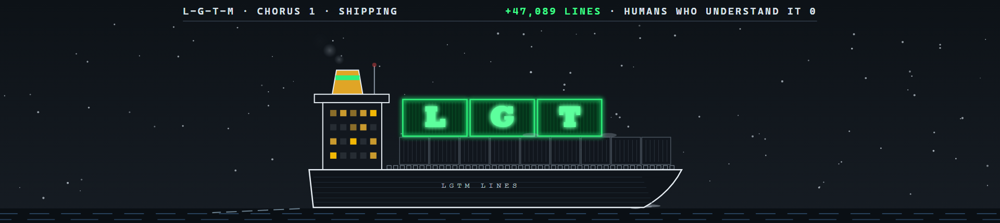

# lgtm-flash

Every time Claude changes your code, the **LGTM Lines** container ship sails across above the prompt.



## How to install

You paste one line. It works even if you only have the Claude desktop app.

### Windows

1. Press the Start button, type `powershell` and press Enter. A window opens.
2. Copy this line, paste it into that window and press Enter:

   ```
   irm https://raw.githubusercontent.com/Ashley-Pettit/lgtm-flash/prod/install.ps1 | iex
   ```

3. Wait until it says **Done**. Then close Claude and open it again.

### Mac

1. Press Command and Space, type `terminal` and press Enter. A window opens.
2. Copy this line, paste it into that window and press Enter:

   ```
   curl -fsSL https://raw.githubusercontent.com/Ashley-Pettit/lgtm-flash/prod/install.sh | bash
   ```

3. Wait until it says **Done**. Then close Claude and open it again.

### Try it

In the Claude desktop app, open the Code tab, type `/lgtm` and press Enter. The ship sails past.

Good to know:

- The line gets Claude Code's command-line tool if you don't have it, then adds the mod. It asks no questions and needs no admin password.
- To get a newer version later, paste the same line again.
- The full animated ship plays in the desktop app's Code tab. If you run Claude Code in a terminal you get a simpler version drawn in text characters.
- Already use Claude Code in a terminal? You can type `/plugin install lgtm-flash --marketplace Ashley-Pettit/lgtm-flash` there instead.

## What happens

It sails in fast, and the **L**, **G**, **T** and **M** containers slam onto its moving deck one by one, each with a bounce, a puff of dust and a camera shake. The ship stops, the camera pushes in, and **LOOKS · GOOD · TO · ME** scans in above the containers, each word drawing a glowing line down to its letter.


The whole thing takes about six seconds, then the prompt is yours again. The header reads **+40,000 LINES THAT I DIDN'T READ**.

## Commands

| Command | What it does |
| --- | --- |
| `/lgtm` | Launch the ship any time |
| `/lgtm 120` | Launch it claiming 120 lines in the header |
| `/testship` | Test the ship: it always sails |

It also launches by itself after every Write, Edit, MultiEdit or NotebookEdit that succeeds.

## What it can reach

It watches file edits as they finish, reading only the file name. It never changes or blocks an edit. It makes no network calls, starts no processes, and reads or writes no files of yours.

## Credit

The ship, the glowing containers and the header strip are a tribute to [LGTM (Looks Good to Me)](https://www.youtube.com/watch?v=3TNpOD6bov8), a Claude music video by Degenerative Pixels. Go watch it.

## More mods by Ash

- [villager-hp](https://github.com/Ashley-Pettit/villager-hp): your Claude usage limits as an animated villager health card above the prompt.

## License

MIT
